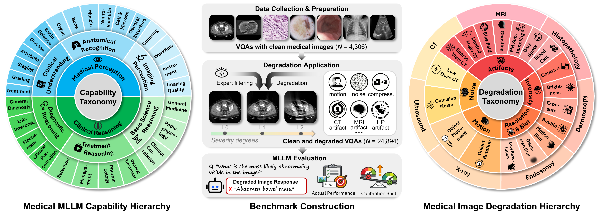
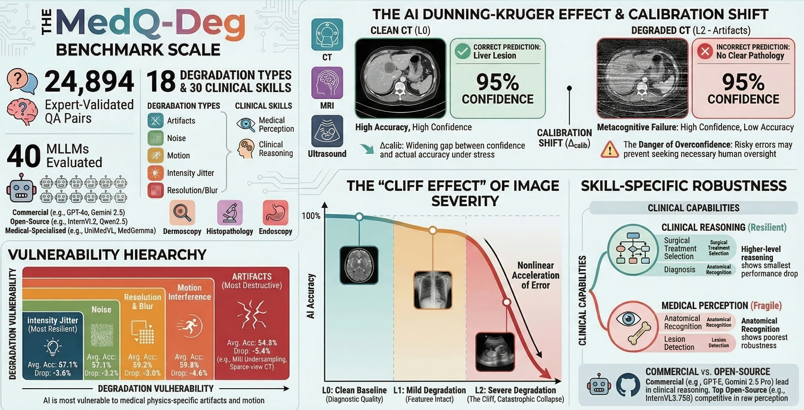
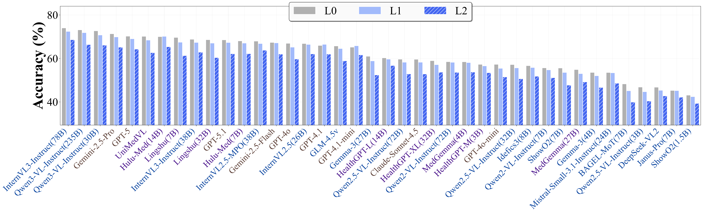

<div align="center">

# MedQ-DEG-Bench: Benchmarking Robustness of Medical VLMs Against Image Degradation

[](https://github.com/liujiyaoFDU/MedQ-DEG)

[](https://arxiv.org/abs/2603.07769)
[](https://opensource.org/licenses/Apache-2.0)
[](https://www.python.org/downloads/release/python-380/)
[](https://huggingface.co/datasets/jiyaoliufd/MedQ-DEG-Bench)
[](https://uni-medical.github.io/MedQ-Robust-web/)

<div>
<strong>Jiyao Liu<sup>1*</sup>, Junzhi Ning<sup>2*</sup>, Chenglong Ma<sup>1*</sup>, Wanying Qu<sup>1</sup>, Jianghan Shen<sup>2</sup>, Siqi Luo<sup>3</sup>, Jinjie Wei<sup>1</sup>, Jin Ye<sup>2</sup>, Pengze Li<sup>2</sup>, Tianbin Li<sup>2</sup>, Jiashi Lin<sup>2</sup>, Hongming Shan<sup>1</sup>, Xinzhe Luo<sup>4</sup>, Xiaohong Liu<sup>3</sup>, Lihao Liu<sup>2</sup>, Junjun He<sup>2&dagger;</sup>, and Ningsheng Xu<sup>1&dagger;</sup></strong>
</div>

<div>
<sup>1</sup>Fudan University, <sup>2</sup>Shanghai AI Lab, <sup>3</sup>Shanghai Jiaotong University, <sup>4</sup>Imperial College London
</div>

<div>
<sup>*</sup>Equal contribution. <sup>&dagger;</sup>Corresponding author.
</div>

<div style="width: 100%; text-align: center; margin:auto;">
    
</div>
</div>

## News

- **[2025.10]** VLMEvalKit integration now supported!
- **[2025.10]** MedQ-DEG-Bench dataset publicly released on [Hugging Face](https://huggingface.co/datasets/jiyaoliufd/MedQ-DEG-Bench)

## Overview

**MedQ-DEG-Bench** is a comprehensive benchmark for evaluating the **robustness** of medical Vision-Language Models (VLMs) against various types of image degradation. In real-world clinical scenarios, medical images often suffer from quality degradation due to equipment limitations, patient motion, and acquisition artifacts. This benchmark systematically measures how such degradations affect VLM diagnostic performance.

### Key Features

- **Systematic Degradation Simulation**: 18 clinically-relevant degradation types across 7 medical imaging modalities
- **Multi-Severity Evaluation**: Each degradation applied at mild and severe levels to quantify robustness gradients
- **Large-Scale Benchmark**: 24,894 samples covering degraded and clean reference images
- **Multi-Source Aggregation**: Samples sourced from 3 established medical VQA datasets
- **Plug-and-Play Evaluation**: Integrated with [VLMEvalKit](https://github.com/open-compass/VLMEvalKit/tree/lite) for seamless model evaluation

## Research Highlights

<div align="center">
<div style="width: 100%; text-align: center; margin:auto;">
    
</div>
<p><strong>Key findings from MedQ-Deg.</strong> The benchmark uncovers three critical phenomena in medical VLM robustness: (i) a <em>Calibration Shift</em> — models sustain high confidence even as accuracy collapses under degradation, posing a silent safety risk in clinical deployment; (ii) a <em>Cliff Effect</em> — accuracy degradation is nonlinear with severity, with catastrophic failure emerging at the severe level; and (iii) differential <em>Skill-Specific Robustness</em> — clinical reasoning remains relatively resilient while medical perception (e.g., anatomical recognition) degrades most severely. Among degradation categories, modality-specific artifacts are the most destructive, causing the largest average accuracy drops.</p>
</div>

## Benchmark Architecture

### Dataset Composition

| Split | Samples | Description |
|-------|---------|-------------|
| `MedQDEGBench_simulate_dev` | 10,392 | Degraded images - development set |
| `MedQDEGBench_simulate_test` | 10,196 | Degraded images - test set |
| `MedQDEGBench_good_dev` | 2,153 | Clean reference images - development set |
| `MedQDEGBench_good_test` | 2,153 | Clean reference images - test set |

### Medical Imaging Modalities

| Modality | Description |
|----------|-------------|
| **CT** | Computed Tomography |
| **MRI** | Magnetic Resonance Imaging |
| **X-ray** | Radiography |
| **Ultrasound** | Ultrasonography |
| **Endoscopy** | Endoscopic Imaging |
| **Dermoscopy** | Dermatoscopic Imaging |
| **Histopathology** | Histological Imaging |

### Degradation Types

We simulate 18 clinically-relevant degradation types across 5 categories. Each degradation is applied at two severity levels: **mild** and **severe**.

**Artifacts (7 types, modality-specific)**

| Degradation | Modality | Description |
|-------------|----------|-------------|
| Limited-angle reconstruction | CT | Under-complete angular sampling producing streak and shadow artifacts |
| Sparse-view reconstruction | CT | Sub-sampled sinogram measurements causing ring artifacts and resolution loss |
| Bias field artifact | MRI | Smooth, spatially varying intensity inhomogeneity mimicking B1 field non-uniformity |
| Undersampling artifact | MRI | Accelerated k-space acquisition causing aliasing and ghosting |
| Ghosting artifact | MRI | Periodic motion-induced Gibbs ringing along the phase-encode direction |
| Blood cell artifact | Histopathology | Erythrocyte-like circular occlusions mimicking hemorrhage contamination |
| Dark spot artifact | Histopathology | Irregularly shaped dark regions mimicking air bubbles or staining precipitates |

**Motion Interference (2 types, general)**

| Degradation | Description |
|-------------|-------------|
| Object rotation | In-plane affine rotation simulating patient repositioning or gantry misalignment |
| Object movement | Random in-plane translation simulating patient displacement |

**Intensity Jitter (3 types, general)**

| Degradation | Description |
|-------------|-------------|
| Brightness adjustment | Uniform pixel intensity shift simulating over- or under-exposure |
| Exposure variation | Non-linear gamma correction mimicking sensor gain variations |
| Contrast reduction | Dynamic range compression simulating suboptimal window/level settings |

**Noise (2 types)**

| Degradation | Modality | Description |
|-------------|----------|-------------|
| Gaussian noise | General | Zero-mean isotropic Gaussian noise modeling thermal detector noise |
| Low-dose noise | CT | Poisson noise model applied to sinogram domain simulating dose-reduced acquisition |

**Resolution & Blur (4 types)**

| Degradation | Modality | Description |
|-------------|----------|-------------|
| Low resolution | General | Downsample and upsample simulating reduced spatial resolution |
| Motion blur | General | Directional convolution kernel modeling camera or patient motion |
| Gaussian blur | General | Isotropic Gaussian low-pass filter simulating optical defocus |
| Bubble | Histopathology | Semi-transparent circular regions mimicking air bubbles beneath coverslip |

## Getting Started

### Dataset Access

The MedQ-DEG-Bench dataset is available on **Hugging Face**: [jiyaoliufd/MedQ-DEG-Bench](https://huggingface.co/datasets/jiyaoliufd/MedQ-DEG-Bench)

### Evaluation with VLMEvalKit

MedQ-DEG-Bench is integrated with [VLMEvalKit](https://github.com/open-compass/VLMEvalKit/tree/lite) for standardized evaluation.

#### Installation

Please refer to the [VLMEvalKit Quick Start Guide](https://github.com/open-compass/VLMEvalKit/blob/lite/docs/en/Quickstart.md) for installation instructions.

#### Usage

```bash
# Evaluate on degraded test set
python run.py --model grok-4 --data MedQDEGBench_simulate_test --api-nproc 32 --retry 3 --reuse

# Evaluate on clean reference test set
python run.py --model grok-4 --data MedQDEGBench_good_test --api-nproc 32 --retry 3 --reuse

# Evaluate on multiple splits
python run.py --model grok-4 --data MedQDEGBench_simulate_test MedQDEGBench_good_test --api-nproc 32 --retry 3 --reuse
```

**Parameters:**
- `--model`: The model to evaluate (e.g., `grok-4`, `gpt-4o`, `qwen2.5-vl-72b`)
- `--data`: Dataset split (see [Dataset Composition](#dataset-composition))
- `--api-nproc`: Number of parallel API calls
- `--retry`: Number of retry attempts for failed API calls
- `--reuse`: Reuse existing results to avoid redundant API calls

### Evaluation Metrics

The benchmark provides multi-dimensional accuracy analysis:

- **Overall Accuracy**: Aggregate performance across all samples
- **By Modality**: Performance breakdown across 7 medical imaging modalities
- **By Degradation Type**: Accuracy for each of 18 degradation types
- **By Severity Level**: Comparison between mild, severe, and clean conditions
- **By Source Dataset**: Performance across different source medical VQA datasets
- **By Capability**: Performance across different medical capability dimensions (e.g., high-level and mid-level capabilities)

## Leaderboard

<div align="center">
<div style="width: 100%; text-align: center; margin:auto;">
    
</div>
</div>

## Related Projects

- [MedQ-Bench](https://github.com/liujiyaoFDU/MedQ-Bench): Evaluating Medical Image Quality Assessment Abilities in MLLMs
- [VLMEvalKit](https://github.com/open-compass/VLMEvalKit/tree/lite): Comprehensive evaluation toolkit for Vision-Language Models

## Citation

If you use MedQ-DEG-Bench in your research, please cite our paper:

```bibtex
@article{liu2026medq,
  title={MedQ-Deg: A Multidimensional Benchmark for Evaluating MLLMs Across Medical Image Quality Degradations},
  author={Jiyao Liu and Junzhi Ning and Chenglong Ma and Wanying Qu and Jianghan Shen and Siqi Luo and Jinjie Wei and Jin Ye and Pengze Li and Tianbin Li and Jiashi Lin and Hongming Shan and Xinzhe Luo and Xiaohong Liu and Lihao Liu and Junjun He and Ningsheng Xu},
  journal={arXiv preprint arXiv:2603.07769},
  year={2026}
}
```

## Contact

- **Jiyao Liu**: [jiyaoliu.fudan@gmail.com](mailto:jiyaoliu.fudan@gmail.com)

## License

This project is licensed under the Apache License 2.0 - see the [LICENSE](LICENSE) file for details.

---

<div align="center">

**If MedQ-DEG-Bench helps your research, please consider giving us a star and citing our paper!**

</div>
